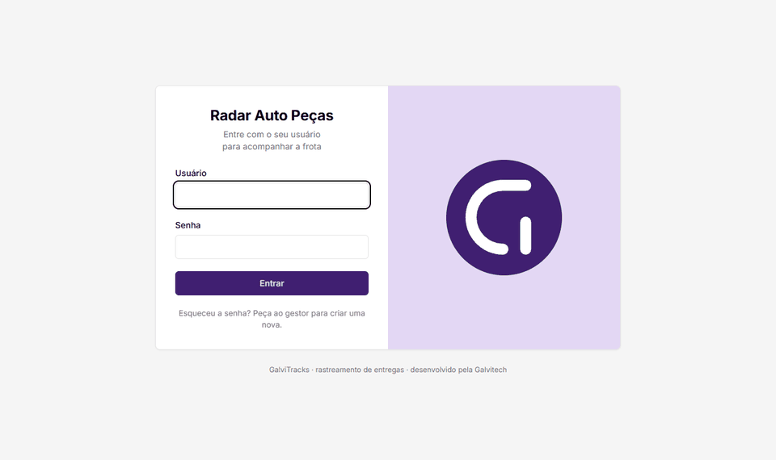
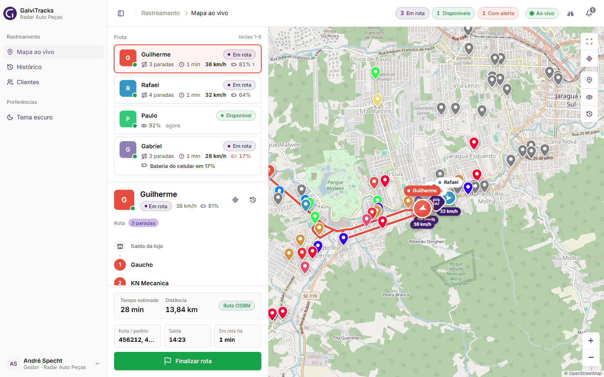
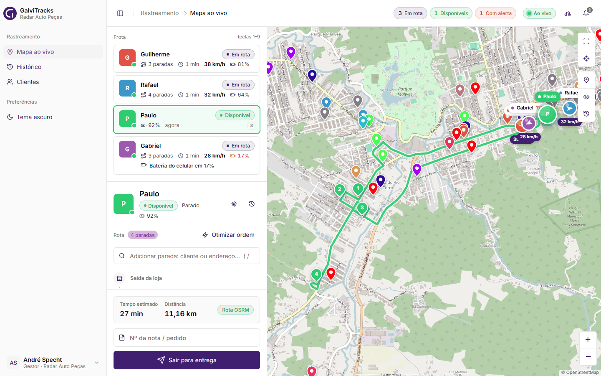
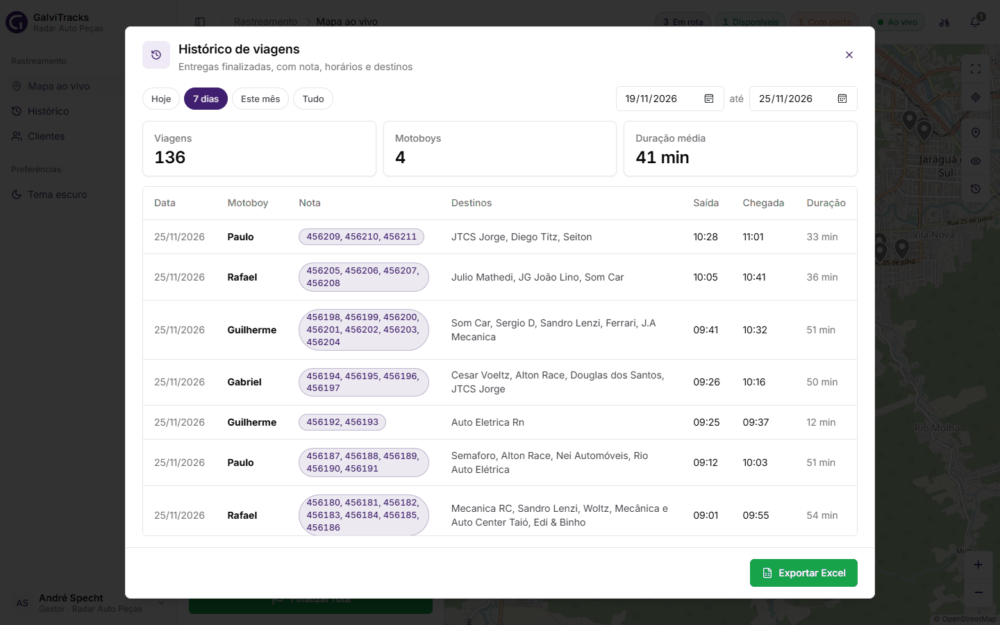
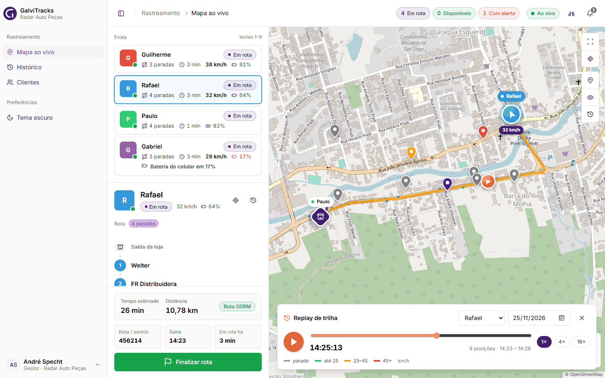
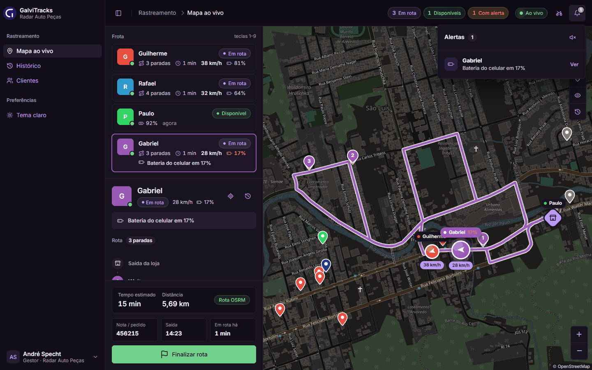
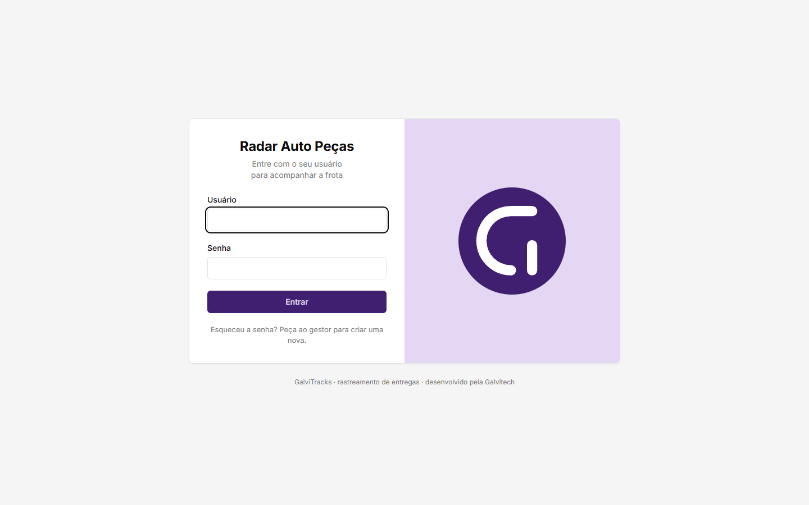
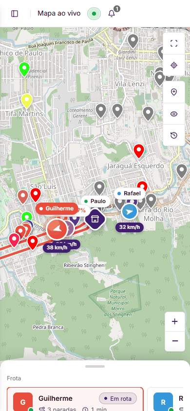
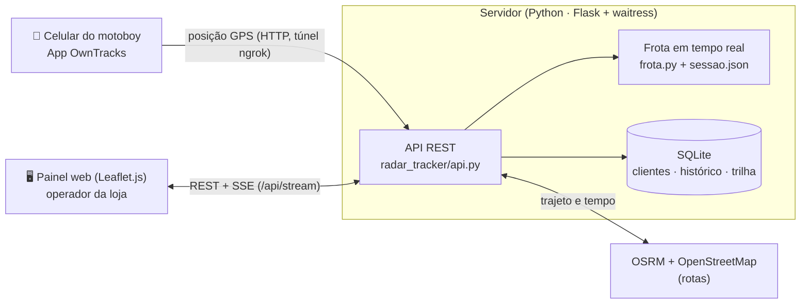

# GalviTracks

Rastreamento de motoboys em tempo real, montagem de rotas e histórico de entregas da **Radar Auto Peças** (Jaraguá do Sul/SC). Desenvolvido pela **Galvitech Ltda** só com tecnologias abertas, roda no computador da própria loja e não tem mensalidade.

[](https://github.com/AndreeSpecht/GalviTracks/actions/workflows/testes.yml)




<sub>Demonstração com motoboys simulados: login, frota andando no mapa, rota otimizada, saída para entrega com o nº da nota e histórico.</sub>

> **Projeto final de curso (portfólio)** · Engenharia de Software · Centro Universitário Católica de Santa Catarina · 2026/2
> Autor: **André Gustavo Specht** · Professora: **Prof.ª Jessica Aline Karsten**

---

## Sumário

- [O problema e a solução](#o-problema-e-a-solução)
- [Telas](#telas)
- [Funcionalidades](#funcionalidades)
- [Destaques técnicos](#destaques-técnicos)
- [Arquitetura](#arquitetura)
- [Tecnologias](#tecnologias)
- [Início rápido](#início-rápido)
- [Usar em outro PC](#usar-em-outro-pc)
- [Estrutura do repositório](#estrutura-do-repositório)
- [Configuração](#configuração)
- [Testes](#testes)
- [Desenvolvimento](#desenvolvimento)
- [Documentação](#documentação)
- [Autor](#autor)

---

## O problema e a solução

A Radar Auto Peças entrega peças às oficinas da região com motoboys próprios. O despacho era manual: o operador definia de memória a ordem das entregas, combinava o trajeto por telefone ou WhatsApp e não sabia onde cada motoboy estava. Não havia registro de quais notas saíram, com quem e quando.

O GalviTracks resolve isso com um sistema web instalado na loja:

- **o celular do motoboy vira o rastreador**, com o app gratuito OwnTracks, sem desenvolver app próprio;
- **o operador vê a frota ao vivo** no mapa, com status, velocidade, bateria e alertas;
- **a rota é montada em segundos**: busca o cliente, ordena as paradas pela mais próxima e mostra tempo e distância pelas ruas reais;
- **toda saída exige o nº da nota** e fica no histórico com motoboy, horários e destinos, exportável para Excel.

Plataformas como Vuupt, Loggi e Foody Delivery atendem parte disso, mas cobram mensalidade, guardam os dados em nuvem de terceiros e são feitas para outros setores.

## Telas

| | |
|:---:|:---:|
|  |  |
| **Frota ao vivo:** cartões com status, velocidade e bateria; rota do motoboy no mapa | **Montagem da rota:** paradas numeradas, ordem otimizada, tempo e distância pelo OSRM |
|  |  |
| **Histórico:** filtros por período, totais e exportação para Excel | **Replay:** reproduz o percurso do dia, colorido pela velocidade |
|  |  |
| **Tema escuro e alertas:** bateria baixa, sem sinal e parada prolongada | **Login:** perfis gestor e operador, no visual do ERP da Galvitech |

<p align="center"><br><sub><b>No celular:</b> mapa em tela cheia e frota em gaveta deslizante</sub></p>

## Funcionalidades

| Funcionalidade | O que faz |
|-----------|-----------|
| **Rastreamento GPS em tempo real** | Mostra os motoboys no mapa com nome, velocidade e direção, a partir do app OwnTracks. Leituras imprecisas ou com saltos impossíveis são descartadas. |
| **Rotas otimizadas** | Monta a rota por cliente cadastrado, endereço ou clique no mapa. Ordena pelo vizinho mais próximo e calcula trajeto e tempo pelo OSRM, com estimativa offline se o serviço cair. |
| **Cadastro de clientes** | Clientes georreferenciados, com telefone e cor do pino, cadastrados no próprio sistema. |
| **Histórico de viagens** | Cada saída exige o nº da nota e é registrada com motoboy, horários e destinos. Filtro por período e exportação Excel. |
| **Replay de trilha** | Reproduz o percurso de um motoboy em um dia, com velocidades 1×, 4× e 16×. |
| **Alertas** | Avisa quando o motoboy fica sem sinal, parado mais de 10 min fora de um cliente ou com bateria baixa. |
| **Login e perfis** | Gestor e operador; o gestor cria e remove usuários pelo próprio painel. |

Outros detalhes do painel: tema claro e escuro, layout para celular, atalhos de teclado (`/` busca, `1`–`9` motoboy, `Esc` fecha, `Ctrl+B` menu) e a mesma identidade visual do ERP de oficinas da Galvitech (roxo `#401F71`, fonte Inter, componentes no estilo shadcn/ui).

## Destaques técnicos

- **Tempo real por Server-Sent Events:** o painel recebe o estado da frota por stream (`/api/stream`), com mudanças agrupadas em janelas de 250 ms; em ensaio com servidor real, a posição chegou ao painel em cerca de 260 ms. Se o stream cair, o painel volta sozinho à consulta a cada 2 s.
- **Filtro de GPS:** descarta leituras com precisão pior que 100 m, fora de ordem ou que impliquem mais de 150 km/h; suaviza a velocidade exibida e corrige horários inválidos do celular.
- **Segurança do túnel:** os celulares chegam ao servidor da loja por um túnel ngrok, mas só o endpoint de GPS passa por ele, e com senha; painel e API respondem 403 de fora da loja. Um teste com túnel real mostrou que o Waitress apagava o cabeçalho que identifica o acesso externo; a correção está coberta por teste.
- **Login:** senhas com hash scrypt, sessão assinada, limite de 5 tentativas em 5 min por IP e recusa de requisições de outros sites.
- **Resiliência:** a rota em andamento sobrevive a um reinício do servidor (sessão gravada de forma atômica), e o cálculo de rotas funciona offline.
- **Instalação em um clique:** o `GalviTracks.exe` (C#) cria o ambiente Python, abre o túnel, sobe o servidor e o painel; fechar a janela encerra tudo.
- **Qualidade:** 145 testes automatizados com GitHub Actions em Windows e Ubuntu (Python 3.10, 3.12 e 3.13).

## Arquitetura



Detalhes, diagramas de estado e sequência e as decisões de projeto estão em [docs/arquitetura.md](docs/arquitetura.md).

## Tecnologias

| Camada | Tecnologia | Função |
|--------|-----------|--------|
| Geolocalização | **OwnTracks** (HTTP) | Envia a posição GPS do motoboy |
| Backend | **Python 3.10+ · Flask · waitress** | API REST, SSE, login e servidor de produção |
| Persistência | **SQLite** (WAL) | Clientes, usuários, histórico de viagens e trilhas GPS |
| Roteirização | **OSRM + OpenStreetMap** | Trajeto e tempo estimado (com fallback offline) |
| Geocodificação | **Nominatim** | Busca de endereços |
| Painel | **Leaflet.js · JavaScript (módulos ES) · CSS** | Mapa interativo e interface, sem framework |
| Relatórios | **openpyxl** | Exportação do histórico em Excel |
| Acesso dos celulares | **ngrok** | Túnel HTTPS até o servidor da loja |
| Instalador | **C# (.NET Framework)** | `GalviTracks.exe` |
| Qualidade | **pytest · GitHub Actions** | 145 testes em Windows e Ubuntu |

## Início rápido

Pré-requisito: **Python 3.10+** ([download](https://www.python.org/downloads/); no Windows marque *Add python.exe to PATH*).

**Windows: um clique**

Abra a pasta do projeto e dê dois cliques em **`GalviTracks.exe`**. Ele faz tudo sozinho:

1. na primeira vez, cria o ambiente Python e instala as dependências (alguns minutos, só uma vez);
2. abre o túnel ngrok para os celulares, se `NGROK_DOMAIN` e `OWNTRACKS_TOKEN` estiverem configurados e o `ngrok.exe` estiver em `tools/`. Pelo túnel só os celulares entram: o painel fica restrito à rede da loja;
3. sobe o servidor e abre o painel no navegador.

Para encerrar, feche a janela do GalviTracks: o servidor e o túnel fecham junto. Se o programa já estiver aberto, um novo clique só abre o painel.

**Linux / macOS**

```bash
git clone https://github.com/AndreeSpecht/GalviTracks.git
cd GalviTracks
./instalar.sh && ./iniciar.sh
```

O painel abre em **http://127.0.0.1:5000**. Na primeira vez, a tela de **primeiro acesso** cria o gestor. Para ver um motoboy andando sem celular, monte uma rota no painel e execute:

```bash
python scripts/simular_motoboy.py --tid 0 --usuario SEU_USUARIO   # use .venv\Scripts\python no Windows
```

Instalação manual, túnel para os celulares (ngrok) e configuração do app OwnTracks estão em **[docs/instalacao.md](docs/instalacao.md)**.

## Usar em outro PC

O repositório já traz tudo o que o sistema precisa: o banco da loja (`data/radar.db`, com os clientes e o histórico), o `.env`, os motoboys (`config/motoboys.json`) e o `tools/ngrok.exe`. Num computador novo com Windows:

**1. Instale uma vez**
- [Python 3.10 ou mais novo](https://www.python.org/downloads/): na instalação, marque **Add python.exe to PATH**.
- [Git para Windows](https://git-scm.com/download/win): pode aceitar as opções padrão.

**2. Baixe o projeto.** Abra o *Prompt de Comando* na pasta onde quer guardar (por exemplo, a Área de Trabalho) e rode:

```bat
git clone https://github.com/AndreeSpecht/GalviTracks.git
```

**3. Abra.** Dê dois cliques em `GalviTracks\GalviTracks.exe`. Na primeira vez ele instala o ambiente Python (alguns minutos); depois sobe o servidor e abre o painel com os clientes da loja.

**4. Responda às duas perguntas da primeira vez.** Na primeira execução em cada PC, a janela do GalviTracks pede duas senhas, que ficam só nesse computador e **não** vão para o GitHub:

- **Senha dos celulares:** a mesma configurada no app OwnTracks de cada motoboy (*Identificação → Senha*). Fica salva no arquivo `.env.local`.
- **Authtoken do ngrok:** o GalviTracks abre a página [dashboard.ngrok.com](https://dashboard.ngrok.com/get-started/your-authtoken); copie o token e cole na janela (botão direito ou Ctrl+V). Fica salvo na configuração do ngrok desse PC.

As senhas aparecem como `*` enquanto você digita. Se apertar Enter sem digitar, o GalviTracks abre só o painel, sem o túnel: as posições dos celulares não chegam, e ele pergunta de novo na próxima vez. Para trocar a senha dos celulares depois, edite ou apague o `.env.local`; para trocar o authtoken, rode `tools\ngrok.exe config add-authtoken NOVO_TOKEN`.

**Mantendo os dados iguais entre os PCs.** O banco não sincroniza sozinho: ele vai para o GitHub como um arquivo.

- **Antes de usar**, pegue a versão mais recente: na pasta `GalviTracks`, rode `git pull`.
- **Depois de usar**, feche a janela do GalviTracks (assim tudo é gravado no banco) e envie:

  ```bat
  git add data/radar.db
  git commit -m "chore: atualiza o banco da loja"
  git push
  ```

  No primeiro `git push` o Windows pede para entrar na conta do GitHub. Se o Git pedir nome e e-mail, configure uma vez com `git config --global user.name "Seu Nome"` e `git config --global user.email "seu@email"`.
- **Use o sistema em um PC por vez.** Se dois PCs alterarem o banco ao mesmo tempo, o Git não consegue juntar os dois e uma das versões precisa ser descartada.

## Estrutura do repositório

```
GalviTracks/
├── radar_tracker/            # aplicação (pacote Python)
│   ├── __init__.py           # create_app()
│   ├── api.py                # endpoints REST + OwnTracks + Excel + bloqueio do acesso externo
│   ├── auth.py               # login, perfis e usuários
│   ├── config.py             # configuração via .env e .env.local
│   ├── db.py                 # SQLite: esquema, migrações, consultas
│   ├── frota.py              # estado dos motoboys + filtro de GPS
│   ├── stream.py             # Server-Sent Events
│   ├── alertas.py            # sem sinal, parado, bateria baixa
│   ├── geo.py                # haversine, velocidade, vizinho mais próximo
│   ├── roteamento.py         # OSRM + fallback offline + Nominatim
│   ├── templates/            # painel e login
│   └── static/               # CSS (design system) e módulos JS do painel (js/main.js)
├── config/motoboys.json
├── scripts/
│   ├── simular_motoboy.py    # simulador do OwnTracks
│   ├── criar_usuario.py      # cria usuários e redefine senhas pelo terminal
│   ├── seed_demo.py          # clientes fictícios
│   ├── windows/launcher/     # código-fonte e compilação do GalviTracks.exe
│   └── docs/                 # gerador do cronograma (.docx/.md)
├── tests/                    # suíte pytest
├── docs/                     # documentação, cronograma e imagens
├── GalviTracks.exe           # Windows: um clique instala, abre o túnel, o servidor e o painel
├── instalar.sh · iniciar.sh  # Linux/macOS
├── run.py                    # ponto de entrada
└── .github/workflows/testes.yml
```

## Configuração

Todas as opções ficam no arquivo `.env` (modelo em [`.env.example`](.env.example)): nome e coordenadas da loja, cidade de busca, servidor OSRM, fator de atraso, token do OwnTracks, limites do filtro de GPS e opções do login (`SECRET_KEY`, `SESSAO_DIAS`, `COOKIE_SEGURO`, `ACESSO_PAINEL_INTERNET`). Senhas ficam no `.env.local`, que não vai para o Git. Os motoboys ficam em `config/motoboys.json` (nome, cor e Tracker ID do OwnTracks).

O banco (`data/radar.db`), o `.env`, o `config/motoboys.json` e o `tools/ngrok.exe` **são versionados**, para que um clone em qualquer PC já abra com os dados da loja.

## Testes

```bash
pip install -r requirements-dev.txt
pytest
```

A suíte cobre as funções geográficas, o filtro de GPS, o ciclo de entrega, todos os endpoints, o OwnTracks, o tempo real, os alertas, o login, o bloqueio do acesso pela internet e a exportação Excel. A rede fica bloqueada durante os testes, o que também valida o modo offline. `python scripts/verificar_stream.py` faz o ensaio de tempo real com o servidor Waitress de verdade.

## Desenvolvimento

O projeto foi construído em entregas semanais, de agosto a dezembro de 2026, a partir de um protótipo usado no balcão da loja em janeiro. Requisitos, arquitetura, GPS, rotas, alertas, tempo real, painel novo, instalador, segurança e login vieram nessa ordem; o caminho está em [docs/desenvolvimento.md](docs/desenvolvimento.md), o cronograma em [docs/cronograma.md](docs/cronograma.md) e as mudanças por versão no [CHANGELOG](CHANGELOG.md).

## Documentação

| Documento | Conteúdo |
|-----------|----------|
| [docs/instalacao.md](docs/instalacao.md) | Instalação, ngrok, OwnTracks, simulador, solução de problemas |
| [docs/requisitos.md](docs/requisitos.md) | Atores, requisitos funcionais e não funcionais, regras de negócio |
| [docs/arquitetura.md](docs/arquitetura.md) | Componentes, camadas, fluxos, algoritmo de rotas, decisões |
| [docs/api.md](docs/api.md) | Referência de todos os endpoints |
| [docs/banco-de-dados.md](docs/banco-de-dados.md) | Modelo ER, sessão da frota, backup |
| [docs/desenvolvimento.md](docs/desenvolvimento.md) | Histórico do desenvolvimento, do protótipo à versão atual |
| [docs/cronograma.md](docs/cronograma.md) | Cronograma de entregas ([versão Word](docs/Cronograma_Entregas.docx)) |
| [CHANGELOG.md](CHANGELOG.md) | Mudanças por versão |

## Autor

**André Gustavo Specht**
Engenharia de Software, Centro Universitário Católica de Santa Catarina (Jaraguá do Sul/SC)
Proprietário da Galvitech Ltda
