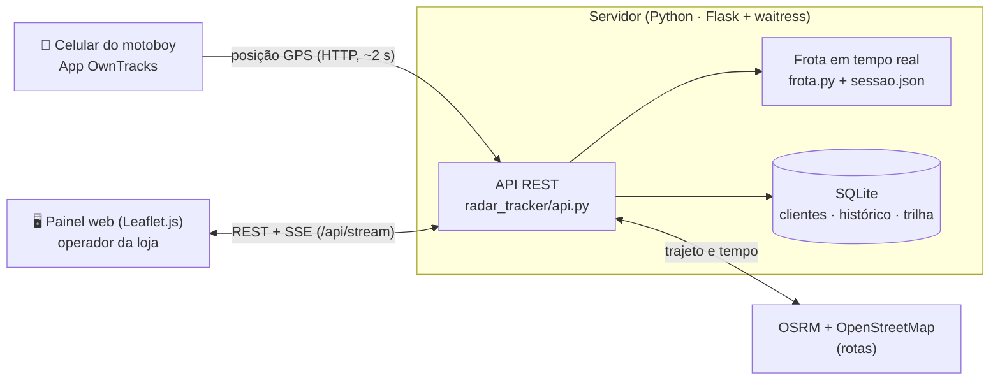

# Sistema de Rastreamento em Tempo Real de Motoboys

Sistema de rastreamento, roteirização e histórico de entregas por motoboy da **Radar Auto Peças** (Jaraguá do Sul/SC), desenvolvido pela **Galvitech Ltda** com tecnologias abertas e sem custos de licenciamento.

[](https://github.com/AndreeSpecht/GalviTracks/actions/workflows/testes.yml)


> **Trabalho de Conclusão de Curso · 8º período (semestre final, 2026/2)**
> Engenharia de Software · Centro Universitário Católica de Santa Catarina
> Autor: **André Gustavo Specht** · Professora: **Prof.ª Jessica Aline Karsten**

---

## Sumário

- [Início rápido](#início-rápido)
- [Usar em outro PC](#usar-em-outro-pc)
- [Funcionalidades](#funcionalidades)
- [Contexto e problema](#contexto-e-problema)
- [Proposta, escopo e diferencial](#proposta-escopo-e-diferencial)
- [Arquitetura](#arquitetura)
- [Tecnologias](#tecnologias)
- [Estrutura do repositório](#estrutura-do-repositório)
- [Configuração](#configuração)
- [Testes](#testes)
- [Metodologia e resultados esperados](#metodologia-e-resultados-esperados)
- [Cronograma de entregas](#cronograma-de-entregas)
- [Documentação](#documentação)
- [Autor](#autor)

---

## Início rápido

Pré-requisito: **Python 3.10+** ([download](https://www.python.org/downloads/); no Windows marque *Add python.exe to PATH*).

**Windows: um clique**

Abra a pasta do projeto e dê dois cliques em **`GalviTracks.exe`**. Ele faz tudo sozinho:

1. na primeira vez, cria o ambiente Python e instala as dependências (alguns minutos, só uma vez);
2. abre o túnel ngrok para os celulares, se `NGROK_DOMAIN` e `OWNTRACKS_TOKEN` estiverem no `.env` e o `ngrok.exe` em `tools/`. Pelo túnel só os celulares entram: o painel fica restrito à rede da loja;
3. sobe o servidor e abre o painel no navegador.

Para encerrar, feche a janela do GalviTracks: o servidor e o túnel fecham junto. Se o programa já estiver aberto, um novo clique só abre o painel.

Para obter o projeto em outro computador, veja [Usar em outro PC](#usar-em-outro-pc).

**Linux / macOS**

```bash
git clone https://github.com/AndreeSpecht/GalviTracks.git
cd GalviTracks
./instalar.sh && ./iniciar.sh
```

O painel abre em **http://127.0.0.1:5000** com os clientes da loja (ou com clientes de demonstração, se o banco estiver vazio). Para ver um motoboy andando sem celular, monte uma rota no painel e execute:

```bash
python scripts/simular_motoboy.py --tid 0      # use .venv\Scripts\python no Windows
```

Instalação manual, túnel para os celulares (ngrok) e configuração do app OwnTracks estão em **[docs/instalacao.md](docs/instalacao.md)**.

## Usar em outro PC

O repositório já traz tudo o que o sistema precisa: o banco da loja (`data/radar.db`, com os clientes e o histórico), o `.env`, os motoboys (`config/motoboys.json`) e o `tools/ngrok.exe`. Num computador novo com Windows:

**1. Instale uma vez**
- [Python 3.10 ou mais novo](https://www.python.org/downloads/): na instalação, marque **Add python.exe to PATH**.
- [Git para Windows](https://git-scm.com/download/win): pode aceitar as opções padrão.

**2. Baixe o projeto.** Abra o *Prompt de Comando* na pasta onde quer guardar (por exemplo, a Área de Trabalho) e rode:

```bat
git clone https://github.com/AndreeSpecht/GalviTracks.git
```

**3. Abra.** Dê dois cliques em `GalviTracks\GalviTracks.exe`. Na primeira vez ele instala o ambiente Python (alguns minutos); depois sobe o servidor e abre o painel com os clientes da loja.

**4. Libere o túnel para os celulares (uma vez por PC).** O authtoken do ngrok é pessoal e não fica no repositório. Copie o seu em [dashboard.ngrok.com](https://dashboard.ngrok.com/get-started/your-authtoken) e rode, dentro da pasta `GalviTracks`:

```bat
tools\ngrok.exe config add-authtoken SEU_TOKEN_AQUI
```

O túnel também só abre com `OWNTRACKS_TOKEN` preenchido no `.env` (a mesma senha configurada no app OwnTracks dos motoboys). Sem o túnel, o painel funciona normalmente, mas as posições dos celulares não chegam.

**Mantendo os dados iguais entre os PCs.** O banco não sincroniza sozinho: ele vai para o GitHub como um arquivo.

- **Antes de usar**, pegue a versão mais recente: na pasta `GalviTracks`, rode `git pull`.
- **Depois de usar**, feche a janela do GalviTracks (assim tudo é gravado no banco) e envie:

  ```bat
  git add data/radar.db
  git commit -m "chore: atualiza o banco da loja"
  git push
  ```

  No primeiro `git push` o Windows pede para entrar na conta do GitHub. Se o Git pedir nome e e-mail, configure uma vez com `git config --global user.name "Seu Nome"` e `git config --global user.email "seu@email"`.
- **Use o sistema em um PC por vez.** Se dois PCs alterarem o banco ao mesmo tempo, o Git não consegue juntar os dois e uma das versões precisa ser descartada.

## Funcionalidades

| # | Funcionalidade | O que faz | Status |
|---|-----------|-----------|--------|
| 1 | **Rastreamento GPS em tempo real** | Mostra todos os motoboys no mapa, com nome e velocidade, atualizando a cada 2 s a partir do app OwnTracks. Leituras imprecisas ou com saltos impossíveis são descartadas. | ✅ |
| 2 | **Gestão e otimização de rotas** | Monta a rota por cliente cadastrado, busca de endereço ou clique no mapa. Calcula trajeto e tempo pelo OSRM, otimiza pela heurística do vizinho mais próximo e tem modo offline. | ✅ |
| 3 | **Cadastro de clientes** | Cadastro georreferenciado com telefone e cor, feito no próprio sistema (clique no mapa ou busca de endereço). | ✅ |
| 4 | **Histórico de viagens** | Cada entrega exige o nº da nota e é registrada com motoboy, horários e destinos. Filtro por período e exportação Excel. | ✅ |
| 5 | **Replay de trilha** | Reproduz o percurso do motoboy em um dia, para auditoria e avaliação. | ✅ |
| 6 | **Alertas de status** | Avisa no painel quando o motoboy fica sem sinal, parado muito tempo fora de um cliente ou com bateria baixa no celular. | ✅ |

### O painel

- **Mapa fluido:** cada motoboy tem um marcador fixo que desliza entre as leituras de GPS (animação a cada quadro), gira na direção do movimento e não pisca ao atualizar. Motoboy sem sinal aparece esmaecido com o tempo desde a última posição.
- **Tempo real:** usa Server-Sent Events (`/api/stream`) quando o servidor oferece e volta sozinho ao polling de 2 s se o stream cair. O indicador no topo mostra *Ao vivo*, *Atualizando* ou *Sem conexão*.
- **Visão da frota:** cartões com status, velocidade, bateria e alertas; resumo do dia no topo (em rota, disponíveis, alertas, entregas e km); central de alertas com aviso na tela e som opcional para alertas críticos.
- **Montagem da rota:** busca única com autocompletar (clientes cadastrados primeiro, depois endereços), paradas numeradas no mapa e na lista, estimativa de tempo e distância e botão de saída que exige o nº da nota.
- **Clientes:** cadastro pelo botão *Novo cliente* (clique no mapa para posicionar), com telefone e cor do pino; edição e exclusão em lista com filtro.
- **Histórico e replay:** filtros rápidos (Hoje, 7 dias, Este mês), totais do período e exportação Excel; replay com play/pausa, velocidades 1×/4×/16× e trilha colorida pela velocidade.
- **Uso confortável:** tema claro e escuro (segue o sistema, com botão para alternar), layout de celular com painel deslizante, atalhos de teclado (`/` busca, `1`–`9` motoboy, `Esc` fecha) e foco visível em todos os controles.

## Contexto e problema

A **Radar Auto Peças** faz boa parte das suas vendas com **entrega por motoboy**. O despacho era manual: não havia rastreamento dos entregadores, cálculo de rotas nem registro estruturado das viagens, e a situação de cada motoboy era acompanhada por telefone ou WhatsApp. As consequências eram:

- impossibilidade de informar **prazos confiáveis** ao cliente;
- dificuldade de **alocar o motoboy mais próximo**;
- **ausência de histórico** para avaliação de desempenho;
- **perda de rastreabilidade** das entregas e das notas despachadas.

> **Pergunta de pesquisa:** *em que medida um sistema de rastreamento em tempo real de motoboys, construído com tecnologias abertas, é capaz de reduzir o tempo de planejamento de rotas e aumentar a eficiência e a rastreabilidade das entregas da Radar Auto Peças?*

## Proposta, escopo e diferencial

Um **sistema web independente**, instalado no computador da loja, que:

- mostra os motoboys no mapa em **tempo real** a partir do celular (app OwnTracks);
- calcula e **otimiza rotas**, com **modo offline** se o serviço de rotas cair;
- registra um **histórico estruturado** de cada viagem com o **número da nota/pedido** digitado pelo operador;
- oferece **replay de trilha** e exportação em Excel;
- é validado em ambiente real com o questionário **SUS**.

**Escopo:** o trabalho abrange somente o sistema de rastreamento. Ele funciona de forma independente e não depende nem se integra a outros sistemas de gestão da loja: os clientes são cadastrados no próprio sistema e o número da nota é informado manualmente.

Plataformas SaaS como Vuupt, Loggi e Foody Delivery confirmam a demanda, mas cobram mensalidade, hospedam os dados em nuvem de terceiros e são voltadas a outros setores. Este sistema usa apenas software livre e roda na própria loja, sem custo de licença.

## Arquitetura



Detalhes, diagramas de estado e sequência e as decisões de projeto estão em [docs/arquitetura.md](docs/arquitetura.md).

## Tecnologias

| Camada | Tecnologia | Função |
|--------|-----------|--------|
| Geolocalização | **OwnTracks** (HTTP) | Envia a posição GPS do motoboy |
| Backend | **Python 3.10+ · Flask · waitress** | API REST, regras de negócio e servidor de produção |
| Persistência | **SQLite** | Clientes, histórico de viagens e trilhas GPS |
| Roteirização | **OSRM + OpenStreetMap** | Trajeto e tempo estimado (com fallback offline) |
| Geocodificação | **Nominatim** | Busca de endereços |
| Visualização | **Leaflet.js** | Mapa interativo |
| Relatórios | **openpyxl** | Exportação do histórico em Excel |
| Qualidade | **pytest · GitHub Actions** | 105 testes em Windows e Ubuntu |

## Estrutura do repositório

```
GalviTracks/
├── radar_tracker/            # aplicação (pacote Python)
│   ├── __init__.py           # create_app()
│   ├── api.py                # endpoints REST + OwnTracks + Excel
│   ├── config.py             # configuração via .env
│   ├── db.py                 # SQLite: esquema, migrações, consultas
│   ├── frota.py              # estado dos motoboys + filtro de GPS
│   ├── geo.py                # haversine, velocidade, vizinho mais próximo
│   ├── roteamento.py         # OSRM + fallback offline + Nominatim
│   ├── templates/index.html  # painel
│   └── static/               # CSS (design system) e módulos JS do painel (js/main.js)
├── config/motoboys.example.json
├── scripts/
│   ├── seed_demo.py          # clientes fictícios
│   ├── simular_motoboy.py    # simulador do OwnTracks
│   ├── windows/launcher/     # código-fonte, ícone e compilação do GalviTracks.exe
│   ├── windows/tunel_ngrok.bat
│   └── docs/                 # gerador do cronograma (.docx/.md)
├── tests/                    # suíte pytest
├── docs/                     # documentação e cronograma
├── GalviTracks.exe          # Windows: um clique instala, abre o túnel, o servidor e o painel
├── instalar.sh · iniciar.sh  # Linux/macOS
├── run.py                    # ponto de entrada
├── requirements.txt · requirements-dev.txt · .env.example
└── .github/workflows/testes.yml
```

## Configuração

Todas as opções ficam no arquivo `.env`, criado pelo instalador a partir de [`.env.example`](.env.example): nome e coordenadas da loja, cidade de busca, servidor OSRM, fator de atraso, token do OwnTracks e limites do filtro de GPS. Os motoboys ficam em `config/motoboys.json` (nome, cor e Tracker ID do OwnTracks).

O banco (`data/radar.db`, com os clientes cadastrados), o `.env`, o `config/motoboys.json` e o `tools/ngrok.exe` **são versionados**: um clone em qualquer PC já abre com os dados da loja. Para levar alterações do banco para o GitHub, feche o GalviTracks e faça commit do `data/radar.db`. Não coloque senhas no `.env` (o repositório é público); o authtoken do ngrok é configurado uma vez por PC (ver [docs/instalacao.md](docs/instalacao.md)).

## Testes

```bash
pip install -r requirements-dev.txt
pytest
```

A suíte cobre as funções geográficas, o ciclo de entrega, o filtro de GPS, todos os endpoints, o OwnTracks (com e sem token), o bloqueio do acesso pela internet e a exportação Excel. A rede fica bloqueada durante os testes, o que também valida o modo offline. O CI roda a cada push em Windows e Ubuntu (Python 3.10, 3.12 e 3.13).

## Metodologia e resultados esperados

O projeto adota a **Design Science Research (DSR)** em quatro etapas: (1) levantamento de requisitos ([docs/requisitos.md](docs/requisitos.md)); (2) projeto da arquitetura e modelagem de dados; (3) implementação incremental com entregas semanais; (4) avaliação em ambiente real com cronometragem do planejamento de rotas (antes/depois) e questionário **SUS**.

Resultados esperados:

- redução do **tempo médio de planejamento de rotas**;
- **dados operacionais estruturados** (posição em tempo real, sequência otimizada de paradas, histórico de viagens);
- **rastreabilidade** das entregas, com o número da nota/pedido registrado no histórico;
- escore **SUS "bom" ou superior** (≥ 71);
- uma alternativa **sem mensalidade** às plataformas SaaS de entrega.

## Cronograma de entregas

Entregas **toda sexta-feira** do semestre final (07/08 a 04/12/2026). Documento completo e editável: **[docs/Cronograma_Entregas_TCC.docx](docs/Cronograma_Entregas_TCC.docx)** · versão web: [docs/cronograma.md](docs/cronograma.md). As semanas 10 a 12 foram replanejadas e entregues em 06/11/2026; a confirmação de entrega por parada saiu do escopo. As semanas futuras estão nos [milestones do GitHub](https://github.com/AndreeSpecht/GalviTracks/milestones).

| Sem. | Sexta | Entrega | Status |
|:---:|:---:|---|:---:|
| 1–2 | 07/08 – 14/08 | Levantamento e validação de requisitos | ✅ |
| 3–4 | 21/08 – 28/08 | Arquitetura, modelo de dados e contrato da API | ✅ |
| 5–6 | 04/09 – 11/09 | Rastreamento GPS (OwnTracks), filtro de GPS e simulador | ✅ |
| 7 | 18/09 | Roteirização OSRM + vizinho mais próximo + offline | ✅ |
| 8 | 25/09 | Refatoração, testes, CI e documentação · **v0.8.0** | ✅ |
| 9 | 02/10 | Alertas: sinal perdido, parada prolongada e bateria baixa | ✅ |
| 10 | 09/10 | Backend em tempo real (SSE), resumo do dia e robustez do GPS | ✅ |
| 11 | 16/10 | Novo painel: mapa fluido, indicadores do dia e replay aprimorado | ✅ |
| 12 | 23/10 | GalviTracks.exe: instalação, túnel, servidor e painel com um clique | ✅ |
| 13 | 30/10 | Segurança do túnel, login de operador e homologação na loja · **v0.9.0** | 🔜 |
| 14–16 | 06/11 – 20/11 | Avaliação real: cronometragem e SUS | 🔜 |
| 17 | 27/11 | Análise dos resultados e escrita do TCC | 🔜 |
| 18 | 04/12 | Revisão final e defesa · **v1.0.0** | 🔜 |

## Documentação

| Documento | Conteúdo |
|-----------|----------|
| [docs/instalacao.md](docs/instalacao.md) | Instalação, ngrok, OwnTracks, simulador, solução de problemas |
| [docs/requisitos.md](docs/requisitos.md) | Atores, requisitos funcionais e não funcionais, regras de negócio |
| [docs/arquitetura.md](docs/arquitetura.md) | Componentes, camadas, fluxos, algoritmo de rotas, decisões |
| [docs/api.md](docs/api.md) | Referência de todos os endpoints |
| [docs/banco-de-dados.md](docs/banco-de-dados.md) | Modelo ER, sessão da frota, backup |
| [docs/desenvolvimento.md](docs/desenvolvimento.md) | Histórico do desenvolvimento, do protótipo à versão atual |
| [docs/cronograma.md](docs/cronograma.md) | Cronograma detalhado de entregas |
| [CHANGELOG.md](CHANGELOG.md) | Mudanças por versão |

## Autor

**André Gustavo Specht**
Engenharia de Software, Centro Universitário Católica de Santa Catarina (Jaraguá do Sul/SC)
Proprietário da Galvitech Ltda

---

<sub>Trabalho de Conclusão de Curso · Engenharia de Software · 8º período (2026/2). Professora: Prof.ª Jessica Aline Karsten.</sub>
