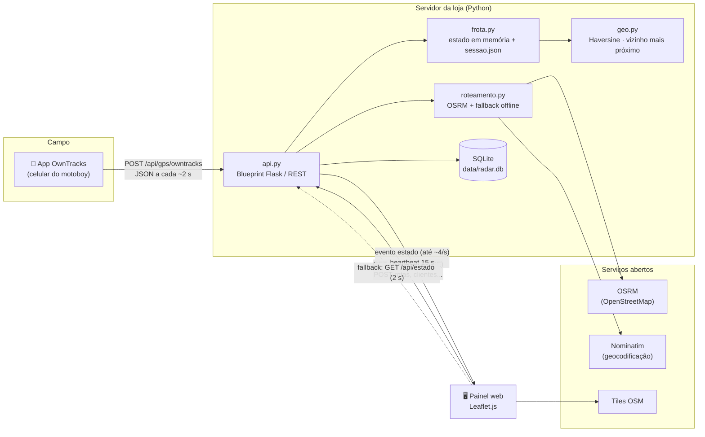
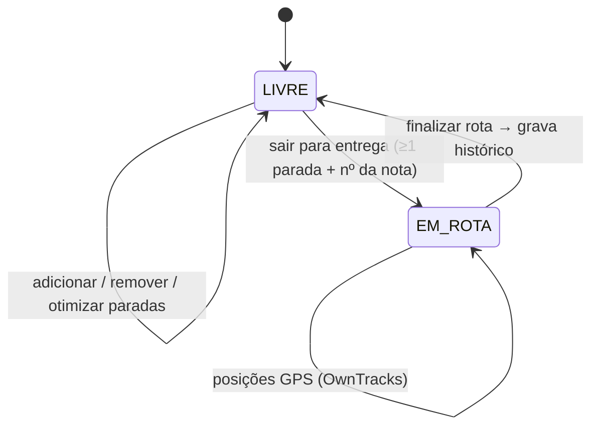
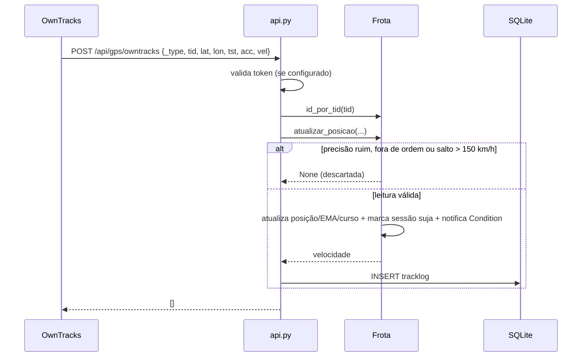

# Arquitetura

## Visão geral

O motoboy não precisa de um app próprio: o **OwnTracks** (gratuito, Android/iOS) é configurado em modo HTTP para enviar a posição ao servidor. Quando o servidor fica atrás de um roteador, o túnel **ngrok** (ou Cloudflare Tunnel) publica o endereço para os celulares.

## Camadas do código

| Arquivo | Responsabilidade | Depende de |
|---------|------------------|------------|
| `run.py` | Linha de comando; sobe o servidor `waitress` (produção) ou o servidor do Flask (`--debug`). | `radar_tracker` |
| `radar_tracker/__init__.py` | `create_app()`: cria o banco, carrega a frota e registra as rotas. | todos |
| `radar_tracker/config.py` | Configuração por variáveis de ambiente / `.env` e leitura de `config/motoboys.json`. | — |
| `radar_tracker/api.py` | Endpoints HTTP, validação de entrada, exportação Excel. | frota, db, roteamento |
| `radar_tracker/frota.py` | Máquina de estados de cada motoboy (`LIVRE` ⇄ `EM_ROTA`), paradas, filtro de GPS, persistência da sessão. | geo |
| `radar_tracker/alertas.py` | Regras dos alertas (sem sinal, parado, bateria baixa) em funções puras, aplicadas ao estado da frota. | geo |
| `radar_tracker/stream.py` | Gerador SSE com agrupamento de eventos, heartbeat e limite de conexões por aplicação. | frota |
| `radar_tracker/geo.py` | Funções puras: distância, velocidade, ordenação de paradas. | — |
| `radar_tracker/roteamento.py` | Chamada ao OSRM e ao Nominatim com *timeout* e *fallback*. | geo, requests |
| `radar_tracker/db.py` | Esquema SQLite, migrações leves e consultas parametrizadas. | sqlite3 |
| `radar_tracker/templates`, `static` | Painel web (HTML, CSS, JS com Leaflet). | — |

As funções de `geo.py` não têm dependências, o que permite testá-las isoladamente. A `Frota` não conhece HTTP nem SQL. Por isso uma eventual troca do SQLite por outro banco fica restrita a `db.py`.

## Ciclo de vida de uma entrega

## Fluxo de uma leitura de GPS

## Cálculo de rota

1. O painel envia as paradas para `POST /api/calc`.
2. O servidor monta o circuito `loja → paradas → loja` e consulta o OSRM (`/route/v1/driving`, *timeout* de 3 s).
3. Com resposta: o tempo é `duração × FATOR_ATRASO` e o traçado (polyline) é decodificado para o mapa.
4. Sem resposta (offline ou erro): a distância em linha reta é somada com Haversine, e o tempo sai de `VELOCIDADE_MEDIA_OFFLINE_KMH` mais `MINUTOS_POR_PARADA` por parada. O painel indica que o valor é uma **estimativa offline**.

### Otimização (vizinho mais próximo)

A partir da posição atual do motoboy (ou da loja), o algoritmo escolhe sempre a parada ainda não visitada mais próxima (Golden & Assad, 1988). A complexidade é O(n²), desprezível para as 2 a 15 paradas típicas de uma rota de motoboy, e o resultado sai na hora, sem depender de serviço externo.

## Tempo real, persistência e execução

Cada mutação incrementa a revisão global da `Frota` e a `versao` do motoboy, acordando uma `threading.Condition`. Cada conexão SSE envia imediatamente o snapshot completo e depois espera nessa condição. Uma janela de 250 ms agrupa mudanças rápidas; não existe fila ilimitada de posições por cliente lento: o próximo evento contém o estado mais recente. O timeout de 15 s envia heartbeat ou atualiza alertas/online dependentes do relógio. O frontend reformado consome SSE; `/api/estado` permanece disponível para o painel antigo e para fallback.

O Waitress usa `THREADS=24`, `STREAM_MAX=10` por padrão. A configuração exige ao menos quatro threads além do limite de SSE para manter GPS e demais APIs disponíveis. Sem vaga, `/api/stream` responde 503 imediatamente. `send_bytes=1` solicita envio de blocos pequenos; `channel_timeout=120` comporta o heartbeat de 15 s, e `channel_request_lookahead=1` disponibiliza a detecção de cliente desconectado. A vaga é liberada no `finally` do gerador ou no fechamento da resposta, com liberação idempotente. Em conexão ociosa, a limpeza ocorre até o próximo heartbeat.

O teste real `python scripts/verificar_stream.py` usa a mesma fábrica de servidor de `run.py`: `curl -N` recebeu eventos individuais, com 20 latências POST→SSE abaixo de 300 ms, e o simulador enviou posições dos quatro motoboys simultaneamente. O teste também verifica saturação/503 e heartbeat. A configuração foi explicitada para envio imediato; não foi necessário instalar middleware, trocar servidor ou acrescentar dependências.

Posição e contato só marcam a sessão como suja. Uma thread grava no máximo a cada `SESSAO_INTERVALO_S=5` segundos durante tráfego contínuo, sem adiar indefinidamente o flush. Edição de rota/status grava imediatamente. Um lock de I/O serializa escritores; o snapshot é feito com lock curto de estado, e só se limpa a marca suja se nenhuma alteração chegou durante a escrita. Arquivo temporário + `os.replace` continuam garantindo troca atômica. `PermissionError` tem três novas tentativas curtas; falha persistente gera aviso e mantém dados sujos para tentar depois. `atexit` e o `finally` de `run.py` fazem flush no encerramento normal. Desligamento forçado pode perder até a última janela de GPS na sessão, mas os pontos já confirmados continuam no SQLite.

O SQLite reutiliza uma conexão por thread, em WAL e `synchronous=NORMAL`, com rollback em exceções e fechamento explícito na parada. Clientes ficam em cache protegido por lock, invalidado junto do commit de criar/editar/colorir/apagar. A retenção remove trilhas anteriores a `TRACKLOG_DIAS=90` ao iniciar e diariamente à meia-noite local; o worker é encerrado com `Event`, sem polling. O índice por timestamp atende à limpeza, e `(moto_id,timestamp)` atende ao replay.

Todo prazo de alerta usa hora do servidor. Timestamp GPS inválido ou mais de cinco minutos no futuro é substituído pela hora do servidor; uma sessão com `last_ts` futuro é saneada na carga. A trilha recebe velocidade bruta e curso; o estado exibe EMA configurável. O replay pode simplificar pontos por Douglas-Peucker, sem modificar o banco. O resumo soma somente segmentos GPS do dia, separados por motoboy.

## Decisões de projeto

| Decisão | Alternativas consideradas | Motivo |
|---------|---------------------------|--------|
| **OwnTracks** no celular | App nativo próprio; rastreador veicular | Gratuito, open source, sem desenvolvimento mobile no escopo do TCC. |
| **SSE com polling de fallback** | WebSocket; somente polling | Fluxo unidirecional, baixa latência, compatibilidade com a API e proxies/túneis, com limite explícito de conexões. |
| **SQLite** | PostgreSQL | Zero instalação e arquivo único, adequado ao volume de uma loja. `db.py` isola a troca futura. |
| **Estado da frota em memória + JSON** | Tabela no banco | Leitura sem SQL, notificações por condição e gravação atômica debounced para reduzir I/O no OneDrive. |
| **OSRM público** com fallback | Google Maps API | Sem custo e sem chave. O fallback cobre indisponibilidade. `OSRM_URL` permite servidor próprio. |
| **waitress** como servidor | gunicorn | Funciona nativamente no Windows, que é o ambiente das lojas. |

## Limitações conhecidas

- O servidor OSRM público tem limite de uso justo. Em produção com muitas lojas, recomenda-se hospedar um OSRM próprio com o recorte de SC.
- O estado da frota fica em um único processo (sem suporte a múltiplas instâncias do servidor).
- O painel ainda não tem autenticação de operador (planejada para a semana 13). Enquanto isso, quem chega pelo túnel só alcança o endpoint do OwnTracks, que exige token; o painel fica restrito à rede da loja.
- Sem GPS, a atualização SSE dos campos derivados do relógio (`online`/`alertas`) ocorre em até 15 s; a avaliação também incrementa a versão do motoboy quando esses campos mudam.
- Estado JSON e histórico SQL não formam transação única entre arquivos. Falha SQL ao finalizar preserva a rota, mas recuperação de interrupção abrupta entre o commit do histórico e a gravação da sessão ainda requer reconciliação.
