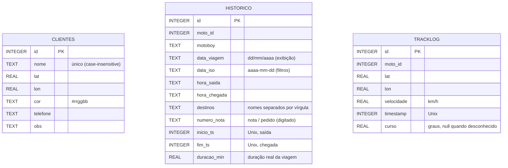

# Modelo de dados

Banco SQLite em `data/radar.db` (configurável por `DB_PATH`). O esquema é criado e migrado automaticamente na inicialização (`Banco.inicializar()`), e as colunas novas são adicionadas sem perder dados de versões anteriores, inclusive do protótipo V79.



Índices: `idx_tracklog_moto_ts (moto_id, timestamp)` para replay, `idx_tracklog_ts (timestamp)` para retenção e `idx_historico_data (data_iso)` para filtros/resumo. Conexões são reutilizadas por thread, com `journal_mode=WAL`, `synchronous=NORMAL`, timeout de lock de 10 s e rollback em erro. Nenhuma conexão SQL fica ocupada durante a espera do SSE.

As novas colunas são adicionadas pelas migrações leves existentes. Em viagens novas, `data_viagem`/`data_iso` vêm de `inicio_ts`, e `duracao_min` é `(fim_ts-inicio_ts)/60`. Em registros antigos, os horários são combinados com `data_viagem` e a chegada passa ao dia seguinte se for anterior à saída. Não é possível reconstruir com exatidão viagens antigas de vários dias; valores ilegíveis permanecem nulos.

`tracklog.curso` mantém metadados dos novos pontos; a velocidade continua bruta, sem a EMA exibida no painel. Pontos antigos têm curso nulo. Retenção configurável: `TRACKLOG_DIAS=90`, limpeza na inicialização e a cada meia-noite local. A limpeza não apaga clientes nem histórico de viagens. Clientes são cacheados em memória e o cache é invalidado em cada mutação do cadastro.

## Estado da frota (`data/sessao.json`)

O estado "vivo" de cada motoboy fica em memória. GPS/contato marcam a sessão suja e são gravados em lote a cada aproximadamente 5 s; rota/status continuam gravando imediatamente. A troca de arquivo continua atômica (temporário + `os.replace`), serializada por lock e com novas tentativas em caso de bloqueio pelo OneDrive. O encerramento normal faz flush. A sessão inclui também `curso`, `ts_posicao`, `precisao`, `versao`, bateria e monitoramento. `online`/`alertas` são derivados na consulta, não gravados. Exemplo parcial:

```json
{
  "0": {
    "status": "EM_ROTA",
    "rota": [{ "nome": "Oficina Centro", "lat": -26.4851, "lon": -49.0713 }],
    "nota": "NF-1001",
    "hora_saida": "14:05",
    "lat_atual": -26.5012,
    "lon_atual": -49.0955,
    "velocidade": 38.5,
    "last_ts": 1790364807
  }
}
```

Nome e cor **não** ficam na sessão; vêm sempre de `config/motoboys.json`. Isso corrigiu o bug do protótipo em que finalizar uma rota apagava esses campos.

## Configuração dos motoboys (`config/motoboys.json`)

```json
[
  { "id": 0, "nome": "Motoboy Um", "cor": "#e74c3c", "tid": "0" }
]
```

`tid` é o *Tracker ID* configurado no app OwnTracks do motoboy (até 2 caracteres). O arquivo real fica fora do Git; o repositório traz apenas `motoboys.example.json`.

## Backup

Para backup por cópia, encerre o servidor antes de copiar a pasta `data/`: com WAL, um banco em uso pode ter transações recentes em `radar.db-wal` e copiar somente `radar.db` não garante consistência. Com o serviço ativo, use a API de backup do SQLite. Para zerar o sistema, encerre-o e apague a pasta: ela é recriada vazia no próximo início, e `python scripts/seed_demo.py` repõe os clientes de demonstração.
